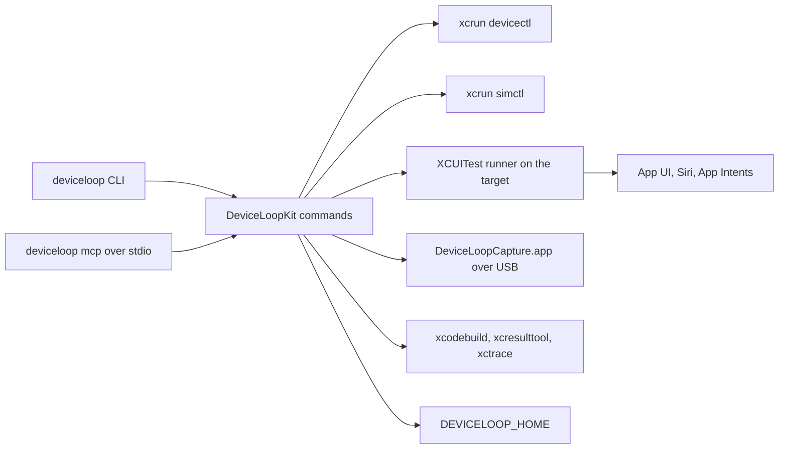

# Architecture

DeviceLoop is one Swift package. `DeviceLoopKit` has one public function per command. The `deviceloop` CLI and the MCP server call the same functions, so a command and its MCP tool pick the same target, run the same backend and return the same errors.

## Backends

- `devicectl` lists and drives devices and simulators. DeviceLoop reads its `--json-output`, not its text output.
- `simctl` covers simulator paths devicectl lacks: screenshot fallback, video, running apps, terminate, the data container, the unified log and status bar overrides.
- The UI runner covers what has no devicectl or simctl command: the accessibility tree, input, alerts, audits, Siri and App Intents.
- The capture helper records device screens over USB with AVFoundation.
- `xcodebuild` runs test suites and finite runner tests, `xcresulttool` reads their result bundles, and `xctrace` records Instruments traces.

Every backend is an Apple developer tool or a public framework. DeviceLoop uses no private frameworks.

A call that needs a CoreDevice capability the target lacks fails with `unsupported_on_target`. [Parity](parity.md#how-deviceloop-routes-a-command) describes how, and lists the backend of each command.

## The UI runner

The runner is an XCUITest bundle in `Runner/UITests` with a small host app in `Runner/Host`. Xcode 27.1 fails a UI test bundle without a host app with "Root install style is not supported on this device".

The first UI command on a target starts the runner:

1. DeviceLoop builds the runner with `xcodebuild build-for-testing`. A simulator build is not signed. A device build is signed with the team that `deviceloop setup` stored and targets that device with `-allowProvisioningUpdates -allowProvisioningDeviceRegistration`. Builds are cached under `DEVICELOOP_HOME/runner`, keyed by every file of the runner project, the toolchain, the configuration, the team and whether the build is for a simulator or a device, and reused only when a completion marker shows the build finished. A cached device build whose profile has expired or does not list the device is rebuilt.
2. It writes a private xctestrun next to the build products that runs only `DeviceLoopRunner/testServe`, with a random token and the address to bind. The system picks the port.
3. `xcodebuild test-without-building` launches it. On a device the runner listens with `NWListener` on the device side of the CoreDevice tunnel, the address devicectl reports as `tunnelIPAddressString`. On a simulator it listens on `::1`. It prints `DEVICELOOP_READY port=<port> v=<version>` when it is ready.
4. DeviceLoop saves `DEVICELOOP_HOME/sessions/<udid>/session.json`. Any DeviceLoop process on the Mac, CLI or MCP, reattaches to the same runner through it.

The Mac reaches the runner through the tunnel CoreDevice already set up. No sudo, iproxy or usbmux is involved.

On a device, the first runner start asks for the passcode to enable UI Automation. When nobody answers, XCTest fails with "Timed out while enabling automation mode". [Requirements and device setup](reference.md#requirements-and-device-setup) describes the prompt and how `deviceloop prepare` retries it.

A per-target session lock, `sessions/<udid>/session.lock`, serializes runner start and stop across processes. Stop asks the runner to shut down, waits up to 45 s for its host process to exit, and does not signal a process ID read from a file. A live runner started by another DeviceLoop version or speaking another protocol is stopped and replaced. That took about 5 s with no passcode prompt on an iPhone 13 Pro, an iPhone 15 Pro Max and an iPad Air (Nov 8th, 2026). `xcodebuild test-without-building` left an older host app installed on an iPhone 13 Pro after a rebuild, so DeviceLoop installs the host app itself when the runner build changes.

With Xcode 27.1 on Oct 22nd, 2026, a runner screenshot took about 210 ms, faster than `devicectl device capture screenshot`. A tap waits for the app to go idle, because XCTest waits for it and no public API skips that wait. [Limits on real devices](reference.md#limits-on-real-devices) has the devicectl screenshot, tree and tap times.

## Operations

The runner serves HTTP/1.1 JSON under `/v1/` with a bearer token. It refuses requests without the token, requests with a browser `Origin` header and POST bodies that are not JSON. The protocol revision is 5. Route names stay the same across revisions, and DeviceLoop refuses to send input to a runner of another revision.

- Admission: the runner runs one XCTest request at a time and queues none. Another request gets `device_busy` and does not run. Health, time and receipt lookups bypass admission.
- Identity: each UI request carries the runner's session epoch (`x-deviceloop-epoch`), a UUID operation ID (`x-deviceloop-operation-id`) and a dispatch budget (`x-deviceloop-dispatch-budget-ms`, default 5000, from 1 to 30000). The runner hashes the method, path, budget and body bytes. A repeat of the same ID and bytes returns the kept response without running again, or `operation_in_progress` while the first one runs. The same ID with other bytes is `operation_conflict`. A wrong epoch is `session_mismatch`. A request still waiting when its budget runs out is `dispatch_expired` and sends no input.
- Receipts: the runner keeps at most 128 finished receipts, for up to 600 s and 16 MiB in all, in memory. A response over 64 KiB is kept as `result_not_retained`, which DeviceLoop reports as `action_outcome_unknown`. `deviceloop runner operation <id> --epoch <epoch>` and the `device_operation` tool read a receipt without sending input.
- Unknown outcomes: when the response to an input is lost, DeviceLoop reports `action_outcome_unknown` and does not send the input again. A new runner has a new epoch, so a lookup with the old epoch gets `session_mismatch` and the old receipts are gone.
- XCTest issues: each response carries the issues XCTest recorded. An issue XCTest marks as a failure fails the call with `xctest_issue`, although the input may have taken effect.
- Refs: a ref from `ui tree` is valid only in the runner process and the observation that issued it. A new tree, any input, an audit, an App Intent run, a change of the app in front or an orientation change makes it stale, and a stale ref fails with `stale_ref` before any input.
- Siri: a Siri request returns HTTP 202 once accepted, and the runner holds admission until XCTest's Siri call returns. [Siri](siri.md) has the measured holds.

Cancelling a client does not cancel work the runner already admitted.

## Finite runs and test jobs

`perf launch` and `perf run` run `DeviceLoopMeasure` from the same runner build in a finite xctestrun. The scenario travels in the xctestrun environment, the test ends, xcodebuild finalizes the result bundle and `xcresulttool` reads the metrics. `test run` runs the developer's own scheme, test plan or `.xctestrun` the same way.

Both are test jobs. A job holds `sessions/<udid>/suite.json` until its xcodebuild exits, which keeps the interactive runner and other jobs off that target. `test run` refuses to start while the interactive runner is up, unless `--stop-runner` stops it first. Over MCP, `test_run` returns a job that `test_status` waits for and `test_cancel` stops.

## Screen video

Simulators record with `simctl io recordVideo`, which writes a frame only when the screen changes.

`devicectl device capture screen-record` needs `com.apple.coredevice.feature.screenrecording`. With Xcode 27.2, an iPhone on iOS 27.2, an iPad on iPadOS 26.6.2 and an iPhone on iOS 18.7.8 did not list it. Devices record over USB instead, with AVFoundation in a helper app, `DeviceLoopCapture.app`, that enables screen capture devices through CoreMediaIO the way QuickTime does. A release tarball and the planned Homebrew formula put the helper, signed with Argmax's Developer ID, in `libexec`. A source build, the way to install today, makes it as `DEVICELOOP_HOME/DeviceLoopCapture.app` from the `deviceloop` executable. macOS asks for camera access for the helper and ties the grant to its identity, so a renamed or re-signed helper asks again. The helper writes a host timestamp for every frame next to the movie, and the frame rate in the analysis is measured from them.

Measured limits on devices:

- The helper picks its AVFoundation source by device name. DeviceLoop refuses to record when another connected device has the same name.
- A capture started less than about 4 s after any USB capture ended, also of another device, found no screen source. DeviceLoop waits 5 s between captures.
- Starting and stopping a USB capture re-enumerates the USB connection and can move the CoreDevice tunnel. On an iPhone 13 Pro on iOS 18.7.8 the runner stopped answering 1.3 to 2 s after the capture started, and an iPhone 15 Pro Max on iOS 27.0 moved to Wi-Fi for about 1.5 s. `video capture` watches the runner for 3 s after the capture starts, replaces it if it went silent and warms it with a tree before the action. [Limits on real devices](reference.md#limits-on-real-devices) has which devices moved their tunnel and how long a capture took.
- Recordings stop after 10 minutes.

Analysis runs on the Mac with AVFoundation. Its gap candidates are estimates from a 60 fps recording, not native hitch metrics. On devices, `video capture --instruments` records an Animation Hitches trace around the capture and marks each candidate confirmed or not from the displayed-surface swaps.

## Instruments traces

`trace record` attaches `xctrace` to the app's process on the target. Traces are large and xctrace crashed when the disk filled, as [Limits on real devices](reference.md#limits-on-real-devices) shows. A 9 s trace of all processes on an iPhone 15 Pro Max left about 9 GB of temporary files next to an 813 MB trace. DeviceLoop runs xctrace with its temporary folder in `DEVICELOOP_HOME/tmp` and removes that folder after each trace. Before it starts, it checks that the temporary and output volumes have about 0.5 GB free per second of recording plus 1 GB. On Oct 22nd, 2026, xctrace could not attach to an app on an iPhone 13 Pro on iOS 18.7.8 by process ID or by name.

## MCP server

`deviceloop mcp` serves MCP over stdio. Each tool calls the `DeviceLoopKit` function of its command. Work that can outlast a client's tool timeout returns a handle: `flow_run` and `test_run` return jobs to poll, `video_record` returns a recording handle and `app_logs` a log handle. `siri test` and `perf` have no tool yet. Each call is logged to `DEVICELOOP_HOME/logs/mcp.jsonl`, as [SECURITY.md](../SECURITY.md#mcp-activity-log) describes. When stdin closes, the server cancels running flows and waits for test jobs to write their summaries.

## Run journal

`run start` creates a run folder under `DEVICELOOP_HOME/runs` and binds it to one target. Until `run stop`, the commands on that target, from the CLI or MCP, append a started and a finished event to it. `setup`, `doctor`, `prepare` and the MCP tools `app_logs` `read` and `stop`, `device_doctor`, `device_prepare`, `device_state`, `flow_status`, `flow_cancel`, `test_status` and `test_cancel` are not journaled.

- `manifest.json`: status, outcome and provenance (Xcode, target, screen, runner build key, app, git commit and whether the checkout had changes). It holds no environment, signing identity or token.
- `events.jsonl`: one line per event, append-only, with a sequence number, wall time and an offset on the Mac's host clock.
- `artifacts/` and `results/`: screenshots, videos and the full result JSON of each command.
- `report.html`: written by `run stop`, along with a hash of every file.

[SECURITY.md](../SECURITY.md#what-deviceloop-stores) lists the text a run journals as `[hidden]`. A run whose owning process exited reads `incomplete`. `run compare` writes its comparison to `runs/comparisons/<id>`, outside both runs, and `run export` copies a run with device names, UDIDs, teams, tokens and the home path replaced by aliases.

## State journal

While a state scope is open, setting commands write each change to a journal before they run, and `state restore` sets the changes back. [Device state](device-state.md) describes it.

## Locks and ownership

| Resource | Guard |
|---|---|
| Runner start and stop | `sessions/<udid>/session.lock` |
| UI input | runner admission, one request at a time |
| Flow runs | `sessions/<udid>/flow.lock`. UI commands, flows, and test and perf jobs that start later get `device_busy` |
| Test and perf jobs | `sessions/<udid>/suite.json` |
| Recordings | the recording handle. A second recording of the target gets `recorder_busy` |
| State scope | `state/<udid>/scope.lock` |

These guard DeviceLoop processes that share one `DEVICELOOP_HOME`. Processes with different `DEVICELOOP_HOME` values do not see each other's runner or jobs on the same device. A UI command that connected before a flow started, another tool, or a person at the device can still send input.

## Files

The [README](reference.md#privacy-and-data-on-disk) lists the folders under `DEVICELOOP_HOME`, and [SECURITY.md](../SECURITY.md#what-deviceloop-stores) what each one keeps and its file modes. Besides the files named on this page, `sessions/<udid>/` holds `automation.json`, the time the last runner became ready, and `host.json`, the runner build whose host app was installed last.
